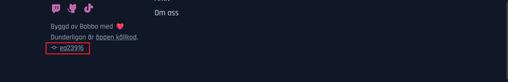

# Deployment

The server and database are hosted on a VPS provided by Linköping University's computer association [Lysator](https://www.lysator.liu.se/). [Coolify](https://coolify.io) is used to automatically deploy changes, configure the reverse proxy (Caddy) and manage Docker containers.

Any pushed changes to the `dev` branch will trigger a redeploy on the [staging site](https://dev.dunderligan.se), while pushes on `master` go straight to [production](https://dunderligan.se). The commit hash of the current version is shown in the footer of the website:

## Docker

The Dockerfile is only used for deployment, while the Docker Compose file is only used for development.

The Dockerfile builds and runs the Node binary. In production the database and other services (currently Postgres and Redis) are managed externally by Coolify, so a Docker Compose isn't needed.

The Docker Compose file is on the other hand used to quickly set up a local environment with the aformentioned services, but doesn't run the app itself.

## Continuous integration

Every push and pull request runs the [`ci` workflow](../.github/workflows/ci.yml), which type-checks, lints and tests the project (`pnpm check`, `pnpm lint` and `pnpm test`).

The workflow copies the `.env.example` file to `.env` to ensure statically typed environment variable imports (`$env/static/public` and `$env/static/private`) are checked correctly.
